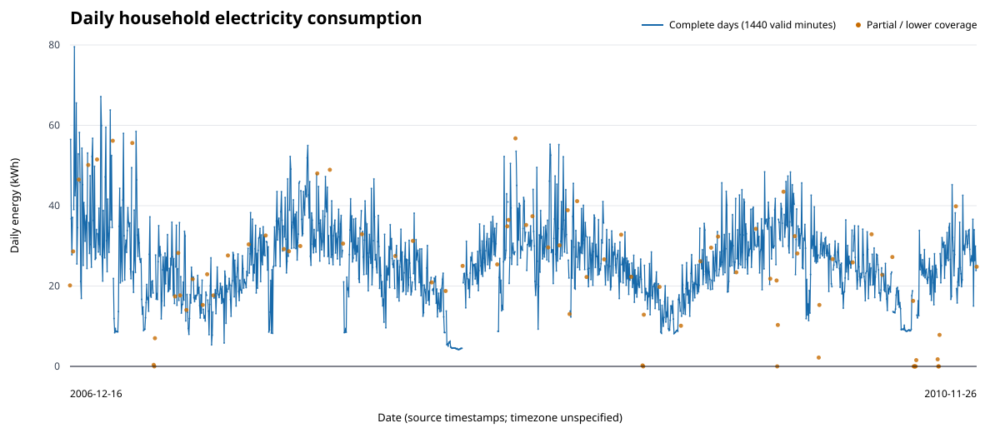

**New retrospective analysis.** June 5, 2024 is a coverage label, not a
work or publication date. This analysis ran on November 14, 2026 at
14:30:55 UTC-08:00. This draft is not published; its publication date is
unknown.

## The question and source

What daily electricity energy can be calculated from the recorded
minute-average power, and how complete are those daily measurements?

The [UCI Individual household electric power consumption dataset](https://archive.ics.uci.edu/dataset/235/individual+household+electric+power+consumption)
([DOI: 10.24432/C58K54](https://doi.org/10.24432/C58K54), CC BY 4.0)
describes **one historical household in Sceaux, France**, not the reader's
home. Its readings run from December 16, 2006 at 17:24 through November 26,
2010 at 21:02; the dataset was donated in 2012. The source does not specify a
timezone, so the analysis keeps timestamps timezone-naive.

## From power to daily energy

`Global_active_power` is a minute-average power in kilowatts. For each date,
the analysis sums the valid minute values and divides by 60, yielding daily
kilowatt-hours. This [exact source revision](https://github.com/dckodi-glitch/electricity-changes/blob/16e57642f3bb5fc21a62bc84f48550f83cbd9081/analysis/household_power.py#L259)
contains the conversion:

```python
energy = record.active_power_sum_kw / Decimal(60)
```

The 2,075,259 source rows include **25,979 missing active-power readings**
(about 1.25%). Missing values are excluded, not imputed. Out of 1,442 dates,
1,358 are complete full calendar days and 84 are partial or incomplete.
Coverage uses expected minute slots clipped to the first and last timestamps;
a complete day must have all 1,440 valid minutes.

{#fig-daily-energy fig-alt="Daily electricity energy in kilowatt-hours from December 2006 to November 2010. Complete days are blue and partial or lower-coverage days are orange. Missing power is excluded, so incomplete-day energy is not a full-day total."}

The [daily table](electricity-2024-06-05-assets/daily_consumption.csv)
includes both energy and coverage. For example:

| Date | Recorded energy (kWh) | Expected minutes | Valid minutes | Complete day |
|---|---:|---:|---:|:---:|
| December 16, 2006 | 20.152933 | 396 | 396 | No |
| December 17, 2006 | 56.507667 | 1,440 | 1,440 | Yes |
| April 29, 2007 | 0.000000 | 1,440 | 0 | No |
| November 26, 2010 | 24.801733 | 1,263 | 1,263 | No |

The zero on April 29 is the sum of **no valid readings**, not evidence of
zero electricity use. Likewise, a partial-day total is not a full-day
estimate. The [quality summary](electricity-2024-06-05-assets/quality_summary.json)
records the missingness and coverage rules.

## Provenance and limits

The [analysis metadata](electricity-2024-06-05-assets/export_metadata.json)
preserves the input archive revision and hash, the execution timestamp and the
original null publication date. It records an uncommitted script at execution;
the script bytes match the SHA-256 of the linked, later merged revision.

These are historical measurements from one household, not current
electricity prices or a general household estimate. Daily totals do not
identify appliance-level use or savings.
