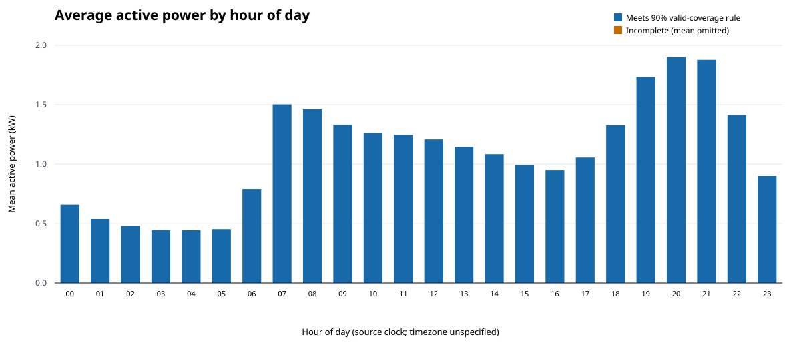

**New retrospective analysis.** August 7, 2024 is a coverage label, not a
work or publication date. This analysis ran on November 24, 2026 at
13:09:50 UTC-08:00. This draft is not published; its publication date is
unknown.

## The question

How did recorded active power vary by source clock hour for one historical
household? The [UCI electricity dataset](https://archive.ics.uci.edu/dataset/235/individual+household+electric+power+consumption)
([DOI: 10.24432/C58K54](https://doi.org/10.24432/C58K54), CC BY 4.0)
describes one home in Sceaux, France, from December 16, 2006 at 17:24 through
November 26, 2010 at 21:02. It is not the reader's household. The source does
not specify a timezone; its clock times remain timezone-naive.

## Hourly profile and coverage

For each clock hour, the analysis averages valid minute-average active-power
readings in kilowatts across the entire observation period. An hourly group
is included only when at least 90% of expected minute slots have valid
readings; otherwise its mean is omitted. Expected slots span the recorded
period, including any timestamp gaps, and missing readings are not imputed.
This threshold applies to each aggregated clock-hour group, not each
individual hour on each day.

{#fig-hourly-power fig-alt="Mean active power by source clock hour in kilowatts. The lowest mean is 0.443847 kW at 04:00 and the highest is 1.899064 kW at 20:00. All 24 groups meet the 90% valid-coverage threshold."}

All 24 groups meet the rule, with valid coverage from 98.598% to 98.959%.
The lowest and highest means are shown below; these are summaries of
recorded readings, not explanations of what caused them.

| Source hour | Mean active power | Valid readings | Expected minutes | Valid coverage |
|---|---:|---:|---:|---:|
| 04:00 | 0.443847 kW | 85,317 | 86,460 | 98.678% |
| 20:00 | 1.899064 kW | 85,615 | 86,520 | 98.954% |

The [hourly table](electricity-2024-08-07-assets/hourly_active_power.csv)
reports valid readings, expected minutes, coverage and inclusion for every
hour. The [quality summary](electricity-2024-08-07-assets/quality_summary.json)
describes the coverage rule.

## Provenance and limits

The [analysis metadata](electricity-2024-08-07-assets/export_metadata.json)
records the input archive revision and hash, observation period and actual
execution timestamp. The
[executed source revision](https://github.com/dckodi-glitch/electricity-changes/blob/2d94f2982173471a49379bcb45e537ebba23f35b/analysis/household_power.py)
and the [preserved source snapshot](electricity-2024-08-07-assets/household_power.py)
have SHA-256 `ac056b355793410ea6a8206844051510a0a56350cb8051d99ebbcb4584c002c3`.
The code was committed before this execution, and the metadata records a clean
working tree. The input archive is pinned to
[revision `929ed43064487e09fe69af58f5c43d5971fa14a4`](https://github.com/dckodi-glitch/electricity-changes/commit/929ed43064487e09fe69af58f5c43d5971fa14a4).

These aggregated measurements cannot identify appliance use, household
behavior or savings. They do not establish current electricity prices or
represent other households.
