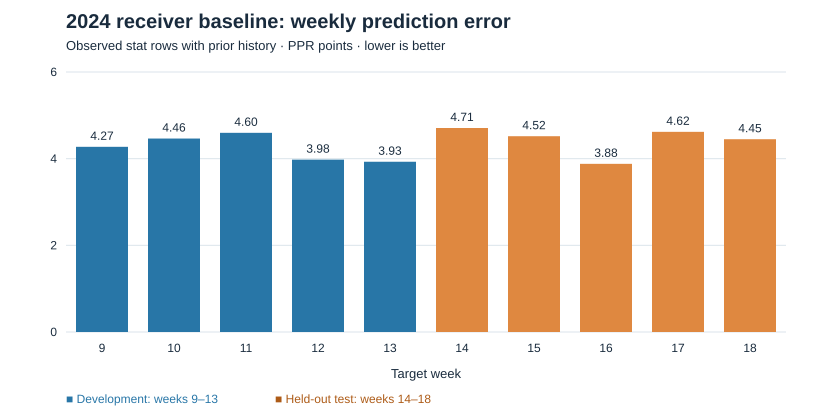

**New retrospective analysis.** January 21, 2026 is a coverage label, not a
work or publication date. This analysis ran on November 23, 2026 at
06:25:57 UTC. This draft is not published; its publication date is unknown.
It examines 2024 receiver statistics, not the original 2025 slot/wide
projections.

## A simple prior-weeks-only baseline

For each receiver, predict the mean PPR points from their earlier observed
scored games, matched by player ID. The target week's score is added to
history only after its prediction; earlier held-out weeks can inform later
held-out predictions. A receiver needs at least one earlier scored row.

The full PPR scoring used here awards one point per reception, one per ten
receiving or rushing yards, six per receiving or rushing touchdown, one per
25 passing yards, four per passing touchdown and minus two per interception.
Sack, rushing and receiving fumbles lost each cost two points; two-point
conversions add two, and special-teams touchdowns add six. There are no
yardage bonuses or separate fumble-recovery touchdown awards. The analysis
checks the calculated score against the source's PPR field for each
complete selected row.

Weeks 1-13 form development: Weeks 1-8 are warm-up and Weeks 9-13 are
evaluated. Weeks 14-18 are held-out test; no model selection or tuning uses
the test period.

## Held-out results

| Eligible observed WR rows | Evaluated | Coverage | MAE | RMSE |
|---:|---:|---:|---:|---:|
| 696 | 686 | 98.56% | 4.43 | 6.48 |

MAE and RMSE are PPR points per evaluated player-game. Ten eligible rows
lacked prior scored history. Coverage is evaluated rows divided by observed
receiver rows with player and game IDs and complete validated scores. In
this test split all 696 candidate rows had those IDs and scores. The
[aggregate summary](fantasy-2026-01-21-assets/summary.csv) contains the
week-by-week and split-level counts and unrounded errors.

{#fig-weekly-mae fig-alt="Weekly mean absolute error in PPR points per evaluated receiver-game for 2024 Weeks 9 through 18. Weeks 9 to 13 are development and Weeks 14 to 18 are held-out test."}

## What this does and does not measure

The source has no inactive designation. A missing player row could indicate
a bye, inactivity or another absence; missing rows and scores are not
treated as zero. Current-week observed rows define the evaluation population
retrospectively, so receiver-row coverage is not lineup coverage or
league-wide performance.

The [source data at its import revision](https://github.com/dckodi-glitch/fantasy-changes/blob/1c0f7b29ff332313cc4d27eb28d1ac635fa31e9f/stats_player_week_2024.csv)
and [exact analysis revision](https://github.com/dckodi-glitch/fantasy-changes/blob/8ca3bba8504b00649b8d3dcc6bfde30cdb7f17eb/retrospective_2024.py)
are pinned separately. The [provenance](fantasy-2026-01-21-assets/provenance.json)
records their hashes and the actual execution time. The later data vintage
does not establish what was available at an original 2024 prediction cutoff.
