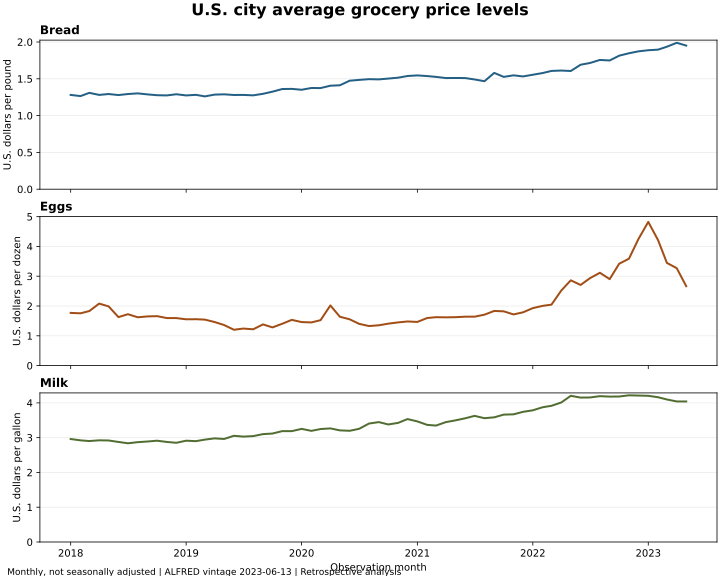

**New retrospective analysis.** The editorial coverage date is June 14, 2023.
The analysis was executed on November 13, 2026 at 16:03:07 UTC-08:00; it was
not documented as work performed in 2023. This post is prepared but not yet
published, so its actual publication date is not known.

## The everyday question

What historical price information could help frame a grocery-budget question
about bread, eggs and milk? The answer here is limited to the information in a
specific archived vintage, not the price at any particular local store.

## A fixed vintage, not a weekly release

The three ALFRED workbooks contain monthly, not seasonally adjusted U.S. city
average price levels for January 2018 through May 2023. Their observation
vintage is **June 13, 2023**. The workbook files themselves were created on
November 13, 2026; the vintage does not establish an exact time of availability
on June 13 or personal activity on June 14.

The underlying Bureau of Labor Statistics series are
[white pan bread](https://alfred.stlouisfed.org/series?seid=APU0000702111),
[Grade A large eggs](https://alfred.stlouisfed.org/series?seid=APU0000708111)
and [fresh whole milk](https://alfred.stlouisfed.org/series?seid=APU0000709112).
The imported [analysis metadata](grocery-2023-06-14-assets/analysis-metadata.json)
keeps the input hashes, data revisions, execution timestamp and original null
publication date.

## What was implemented

The retrospective analysis reads both sheets in each workbook, checks the
series metadata and monthly coverage, then exports a quality table, monthly
price table and a chart. It keeps the original workbooks unchanged and does
not combine prices measured in different units.

{#fig-price-history fig-alt="Three separate monthly price charts from January 2018 to May 2023. Egg prices peak at $4.823 per dozen in January 2023 and fall to $2.666 in May; bread and milk use their own scales and units."}

The [exported monthly table](grocery-2023-06-14-assets/monthly-prices.csv)
supports the May 2023 price levels below. These are levels for different
quantities, not a directly comparable shopping basket.

| Item | May 2023 price | Unit |
|---|---:|---|
| White pan bread | $1.951 | per pound |
| Grade A large eggs | $2.666 | per dozen |
| Fresh whole milk | $4.042 | per gallon |

Each workbook contains 65 monthly observations. The
[quality export](grocery-2023-06-14-assets/data-quality.csv) reports no
duplicate dates, missing months, malformed dates, missing values, invalid
values or out-of-range dates in any of the three series.

| Series | Months | Duplicate dates | Missing months | Missing values |
|---|---:|---:|---:|---:|
| Bread | 65 | 0 | 0 | 0 |
| Eggs | 65 | 0 | 0 | 0 |
| Milk | 65 | 0 | 0 | 0 |

This short, non-executed excerpt from
[the exact analysis code revision](https://github.com/dckodi-glitch/grocery-changes/blob/e555df70bd62f971386674f82b83f5c5f7c183b0/analyze.py#L225-L227)
writes each item's month, price and unit separately:

```python
for data in series:
    for month, price in data["rows"]:
        writer.writerow([data["item"], data["series_id"], month.isoformat(), f"{price:.3f}", data["unit"]])
```

The linked merge commit was created after the recorded execution. Its
`analyze.py` bytes match the analysis source SHA-256 in the imported metadata;
the commit date is not presented as the execution date.

## Limits and a next step

These are U.S. city averages, not local store prices, and the products have
different units and definitions. They do not imply nutritional equivalence or
causation. The workbooks caution that average prices are best used for price
levels rather than measuring price change; the
[BLS methodology](https://www.bls.gov/cpi/factsheets/average-prices.htm)
recommends appropriate CPI indexes for that purpose.

A practical next milestone is to document which CPI index series would be
needed for a separate, properly labeled price-change comparison, without
treating these average-price levels as inflation measures.
