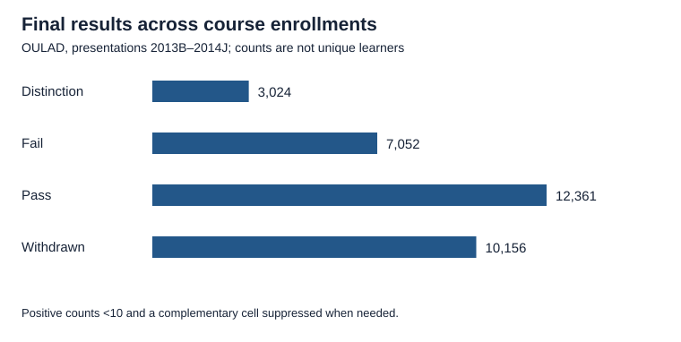

**New retrospective analysis.** February 4, 2026 is a coverage label, not a
work or publication date. This analysis ran on November 23, 2026 at
06:33:35 UTC. This draft is not published; its publication date is unknown.

## What is in the data?

The [Open University Learning Analytics Dataset](https://archive.ics.uci.edu/dataset/349/open+university+learning+analytics+dataset)
([DOI: 10.24432/C5KK69](https://doi.org/10.24432/C5KK69), [CC BY 4.0](https://creativecommons.org/licenses/by/4.0/))
describes Open University presentations in 2013 and 2014. The five tables
used here are:

| Table | Contents | Checked candidate key |
|---|---|---|
| `courses.csv` | Module presentations | Module and presentation |
| `studentInfo.csv` | Enrollment and final result | Module, presentation and learner |
| `studentRegistration.csv` | Registration dates | Module, presentation and learner |
| `assessments.csv` | Assessment definitions | Assessment ID |
| `studentAssessment.csv` | Assessment submissions | Assessment ID and learner |

These are keys checked in the local inputs. The 22 presentations across seven
modules run from 234 to 269 days and have 206 assessment definitions. The
data include 32,593 enrollments and 173,912 submissions. The
[quality summary](learning-2026-02-04-assets/data_quality.json) also records
missing values, including 11 assessment deadlines and 173 submission scores.

## Joins and privacy

The workflow checks unique, nonmissing keys and referential integrity.
Registration matches the enrollment table on the full module, presentation
and learner key; submissions match an assessment and then the corresponding
enrollment. The checks found no unmatched keys or fanout in these joins.
Joining only on learner ID could incorrectly connect different presentations.
This short excerpt from the [exact analysis revision](https://github.com/dckodi-glitch/online-changes/blob/2859cb40d9a120a86eb12d7c1407cd2f80c66c01/oulad/analyze.py#L117-L119)
constructs the enrollment key:

```python
enrollment_key = (*key(assessment, PRESENTATION), row["id_student"])
if enrollment_key not in info:
    checks["submission_missing_enrollment"] += 1
```

Only aggregate outputs are copied here, not learner records or joined
learner-level files. Small positive learner counts below 10 are suppressed,
with complementary suppression where needed; these checks do not prevent
every possible inference using outside information.

## Enrollment results and limitations

{#fig-enrollment-results fig-alt="Bar chart of enrollment results: Pass 12,361, Withdrawn 10,156, Fail 7,052 and Distinction 3,024. Counts are enrollments, not unique people."}

These [counts](learning-2026-02-04-assets/final_results.csv) are enrollments,
not unique people: some people appear in more than one presentation.
`OULAD.names` lists 32,953 students/registrations, but its class distribution
totals 32,593 and both local enrollment tables have 32,593 rows. The cause
of this discrepancy is unknown; the source has not been corrected.

This is a descriptive historical snapshot, not a prediction or a causal
comparison of learning platforms. The separate platform dataset and notebook,
described in the project context as a December 2025 study, are not joined to
OULAD. The [provenance](learning-2026-02-04-assets/provenance.json) records
the input revisions, source hashes and execution date. The analysis source
was committed after execution and matches its recorded hash.
