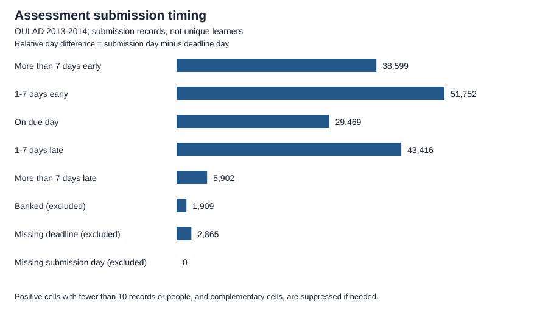

**New retrospective analysis.** August 5, 2026 is a coverage label, not a
work or publication date. This analysis ran on November 24, 2026 at
21:25:57 UTC. This draft is not published; its publication date is unknown.

## What does the timing measure?

The [Open University Learning Analytics Dataset](https://archive.ics.uci.edu/dataset/349/open+university+learning+analytics+dataset)
([DOI: 10.24432/C5KK69](https://doi.org/10.24432/C5KK69), [CC BY 4.0](https://creativecommons.org/licenses/by/4.0/))
includes 2013-2014 course presentations. Both submission day and assessment
deadline are days relative to the start of their presentation, not calendar
dates. The analysis subtracts the deadline day from the submission day:
negative means early, zero means on the due day, and positive means late.

Among **169,138 comparable non-banked submissions**, the distribution is:

| Timing relative to deadline | Submission records |
|---|---:|
| More than 7 days early | 38,599 |
| 1-7 days early | 51,752 |
| On due day | 29,469 |
| 1-7 days late | 43,416 |
| More than 7 days late | 5,902 |

{#fig-submission-timing fig-alt="Bar chart of OULAD submission records: 38,599 more than seven days early, 51,752 one to seven days early, 29,469 on the due day, 43,416 one to seven days late, and 5,902 more than seven days late. Exclusions are 1,909 banked records, 2,865 missing deadlines and zero missing submission days."}

The [aggregate table](learning-2026-08-05-assets/submission_timing.csv)
also reports exclusions: 1,909 banked records, followed by 2,865 records
without a deadline and zero with a missing submission day. Categories are
assigned in that order, so a banked record is not counted again for a missing
deadline. Banked scores may originate in a previous presentation. Scores
are not used to determine inclusion; a missing score does not exclude an
otherwise comparable submission.

## Checks and limitations

The workflow validates assessment and enrollment keys and their
relationships before joining each submission through its assessment to the
full module, presentation and learner enrollment key. It exports no joined
learner-level records. Positive cells with fewer than 10 records or distinct
learners are suppressed, with complementary suppression when needed to
prevent simple subtraction. The figure is generated from the aggregate
table; these controls cannot prevent every inference using external data.

These are recorded submissions, not unique people or all scheduled
assessments. Timing is descriptive: no model is trained and no conclusion is
drawn that lateness causes a final result. The separate December 2025
platform study is not joined to OULAD.

The [provenance](learning-2026-08-05-assets/provenance.json) records input
revision `9f2ff2d60ef4ffa09f3fa763ac000b7c9a512ab0`, input hashes and the
actual execution date. The timing code was uncommitted at execution: its
Git blob is `ae0c4d5947637a8a451dc4a85ae1451c2053feba` and SHA-256 is
`fc44d12f3632706f3a5eb0b4b7ca05484567d461c86d85e62bc8fe2850aaa448`.
An exact timing-code commit permalink is not yet available.
